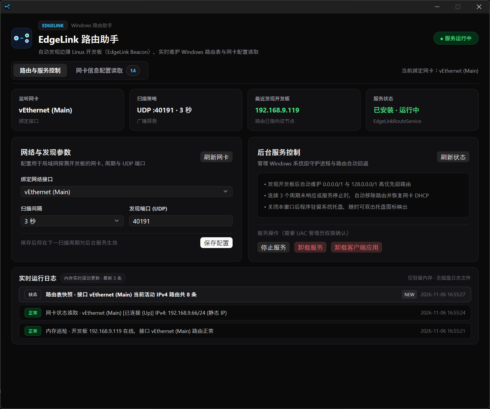
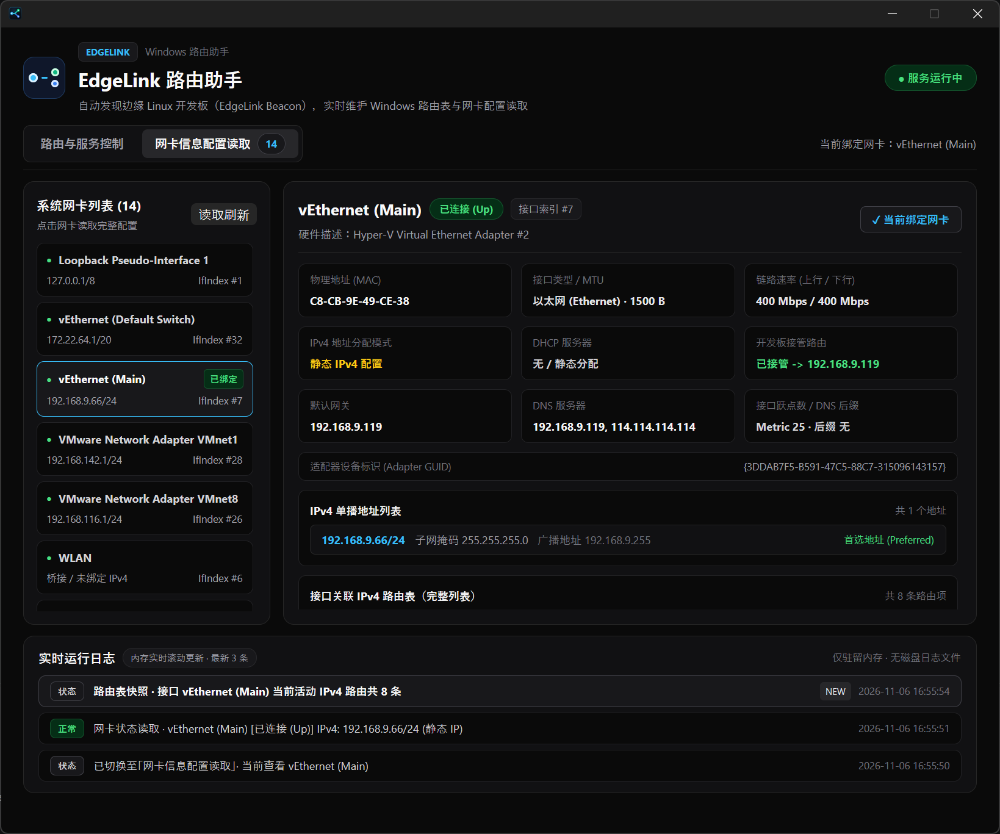
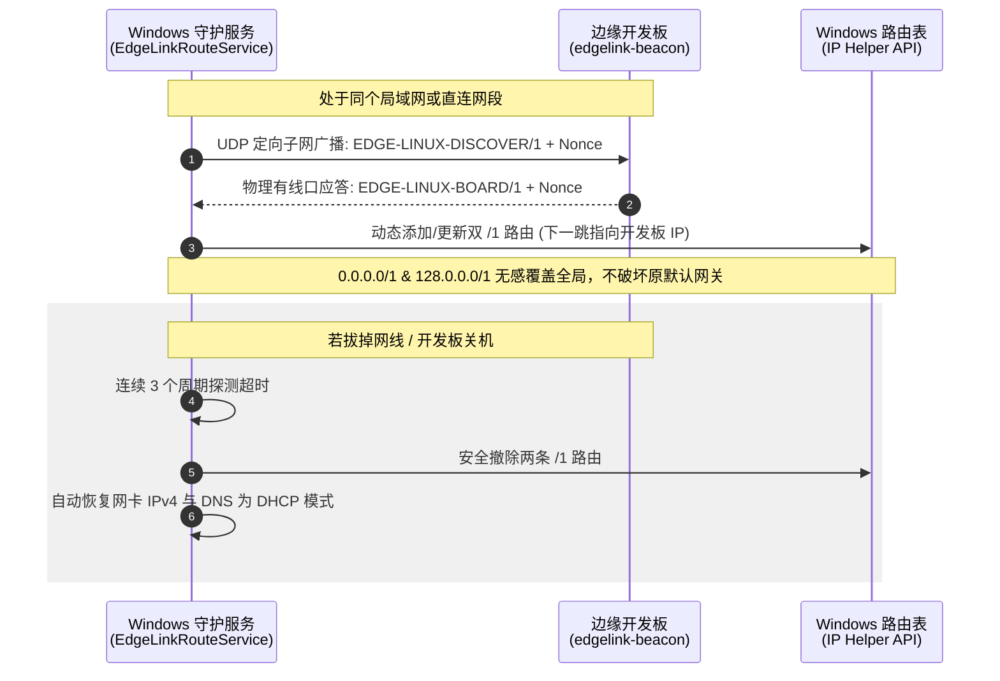

# EdgeLink (棱镜互联)

> **面向嵌入式 Linux 开发板与 Windows 开发主机的局域网动态互联与无感自动路由管理套件**

[](https://www.rust-lang.org/)
[](https://github.com/)
[](https://opensource.org/)

---

## 📖 简介

在嵌入式 AI、机器人感知与边缘计算开发中，工程师经常通过网线直连或局域网交换机将 Linux 开发板（如 RK3588、全志、树莓派等）连接至 Windows 电脑。传统模式下，设备 IP 变动或直连链路往往需要人工反复配置静态 IP、修改 Windows 路由表或使用繁琐的串口指令。

**EdgeLink（棱镜互联）** 提供了一整套软硬件协同的自动化解决方案：
- **开发板端（`edgelink-beacon`）**：以极轻量级的 Linux systemd 后台服务运行，监听本地有线网络请求。
- **Windows 端（`edgelink-router`）**：提供现代化深色桌面控制台与系统守护服务（SCM），通过 UDP 定向广播秒级捕获开发板信标，自动通过 Windows IP Helper API 维护两条 IPv4 `/1` 路由，实现“插线即通、拔线恢复、动态无感”。

---

## 📸 界面预览与核心功能

### 1. 路由与后台服务守护面板（Tab 1）



- **服务生命周期管理**：直观展示 Windows 后台守护服务（`EdgeLinkRouteService`）当前运行状态（运行中 / 已停止 / 未安装），支持一键提权安装、启动、停止与卸载。
- **扫描参数与网卡绑定**：支持灵活调整广播心跳间隔（1s / 2s / 5s / 10s / 30s），智能锁定目标物理网卡。
- **内存事件日志流**：采用纯内存循环队列记录关键心跳与路由变更事件，界面滚动直观呈现，不产生冗余本地日志文件。

### 2. 网卡信息配置读取面板（Tab 2）



- **全接口覆盖读取**：自动枚举并列出系统内所有的网络适配器，包括有线以太网、Wi-Fi 无线网卡、Hyper-V 虚拟交换机及 VMware 适配器。
- **深度硬件与网络指标**：
  - 物理地址 (MAC)
  - 接口类型与 MTU (以太网 / 无线局域网 / 1500 B 等)
  - 链路速率（当前协商的上行/下行速率）
  - IPv4 分配模式（静态分配 / DHCP 动态获取）
  - 默认网关与首选/备用 DNS 服务器列表
- **接口关联路由表洞察**：无需在命令行执行 `route print`，直接精准提取该网卡名下生效的关键 IPv4 路由条目、目标网段、下一跳与接口跃点数 (Metric)。

### 3. 系统级无感使用体验

- **暗黑极简设计**：基于 GPUI 渲染引擎打造原生深色质感控制台，与现代开发环境完美融合。
- **托盘常驻与无弹窗**：彻底移除多余控制台黑框；关闭主窗口后自动退入系统任务栏托盘，右键托盘支持快捷启停后台服务或退出。

---

## 🧩 架构组成

```text
EdgeLink/
├── edgelink-beacon/          # 【板端】Linux UDP 动态信标服务
│   ├── packaging/            # Debian .deb 打包配置与 systemd 单元文件
│   └── src/                  # 纯安全 Rust 编写，过滤虚拟/无线网卡，只应答物理有线接口
└── edgelink-router/          # 【桌面端】Windows 桌面助手、守护服务与安装向导
    ├── packaging/            # 单文件 Windows 安装包生成脚本 (PowerShell)
    ├── src/
    │   ├── bin/
    │   │   ├── edgelink-service.rs   # Windows SCM 独立守护服务 (EdgeLinkRouteService)
    │   │   └── edgelink-setup.rs     # 自解压安装向导与卸载引擎 (uninstall.exe)
    │   ├── ui/                       # 基于 GPUI Kit 的高性能桌面 UI
    │   └── main.rs                   # 桌面 GUI 客户端主程序
    └── Cargo.toml
```

---

## ⚡ 核心工作原理



1. **子网定向广播探测**：Windows 客户端仅向选定网卡的 IPv4 掩码广播地址发送探测请求，避免全网段 254 个 IP 暴力扫描带来的网络抖动。
2. **随机 Nonce 防碰撞**：每次广播均携带独立的随机 Nonce 票据，杜绝旧报文回放与网络脏数据干扰。
3. **双 `/1` 细分路由接管**：Windows 端通过注入 `0.0.0.0/1` 和 `128.0.0.0/1` 路由，在遵循最长前缀匹配原则优先转发给开发板的同时，完全保留网卡原有的默认网关与跃点配置。
4. **安全断开恢复机制**：开发板离线连续达到 3 次心跳周期后，守护服务自动清理写入的路由，并将网卡回退为 DHCP，避免断开设备后开发机断网。

---

## 🚀 快速上手与安装

### 1. 开发板端安装 (Debian / Ubuntu / Armbian)

开发板支持 x86_64 及 ARM64 架构。在开发板上直接安装最新构建好的 `.deb` 包：

```bash
# 在 Linux 开发板上运行
sudo apt install ./dist/edgelink-beacon_0.1.0_arm64.deb

# 查看运行状态
sudo systemctl status edgelink-beacon
```

服务将自动注册为 systemd 开机自启，并以安全的 `DynamicUser` 低权限运行。

### 2. Windows 开发机安装

从 [dist/](file:///d:/code/edge-linux-systems-lab/dist/) 目录下载安装程序：
- **安装包路径**：`dist/edgelink-router_0.1.0_x64_setup.exe`

运行安装向导后：
- 自动部署至 `C:\Program Files\EdgeLink\`；
- 注册并启动 Windows 后台服务 `EdgeLinkRouteService`（开机自启动）；
- 创建开始菜单与桌面快捷方式；
- 集成 Windows 控制面板标准卸载支持（或运行 `C:\Program Files\EdgeLink\uninstall.exe`）。

---

## 🛠️ 源码构建

### 开发板端编译 (100% Musl 完全静态链接，零 glibc 依赖)

`edgelink-beacon` 默认采用 **musl libc** 进行全静态编译，生成的二进制没有任何动态库依赖，保证在任何 Linux 发行版（Ubuntu 16.04~24.04、Debian、Armbian、CentOS、Buildroot、Alpine、OpenWrt 等）和不同内核版本上都能 100% 直接运行。

```bash
cd EdgeLink/edgelink-beacon

# 1. 交叉构建 ARM64 静态 deb 安装包 (RK3588, 树莓派等)
bash packaging/build-deb.sh --arch arm64

# 2. 构建 Linux x86_64 静态 deb 安装包
bash packaging/build-deb.sh --arch x86_64

# 3. 一键同时生成 x86_64 与 ARM64 双架构静态安装包
bash packaging/build-deb.sh --all
```

### Windows 端编译与打包

```powershell
cd EdgeLink\edgelink-router

# 1. 编译三合一二进制
cargo build --release

# 2. 生成单文件独立安装向导 (输出至 dist/edgelink-router_0.1.0_x64_setup.exe)
powershell -ExecutionPolicy Bypass -File packaging\build-installer.ps1 -Profile release
```

---

## 🤖 GitHub 自动化发布

项目内置全自动化 GitHub Actions 工作流：
- **Tag 自动发布**：推送以 `v` 开头的版本标签（如 `git tag v0.1.0 && git push origin v0.1.0`）时，自动触发跨平台编译打包与 GitHub Release 发布。
- **发布产物**：
  - `edgelink-beacon_*_arm64.deb` / `edgelink-beacon_*_amd64.deb`
  - `edgelink-router_*_x64_setup.exe`（单文件安装包）
  - `edgelink-router_*_windows_x64_portable.zip`（绿色便携包）
  - `SHA256SUMS.txt`（完整校验码）
- **手动触发**：支持在 GitHub Actions 页面通过 `workflow_dispatch` 手动输入 Tag 触发构建发布。

---

## 📜 开源协议

本项目采用 MIT / Apache-2.0 双重开源许可协议。欢迎提交 Issue 与 Pull Request！
